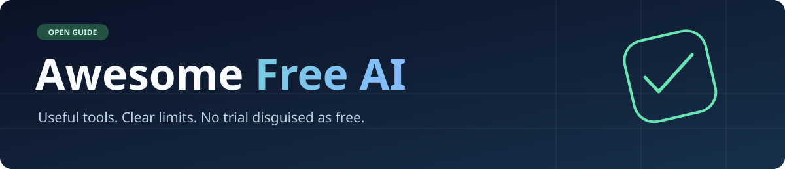

# Awesome Free AI

  

**AI tools you can actually try for free.** A practical directory of online services, developer APIs, and AI software you can run locally.

> **Review in progress — October 2026.** Most descriptions below date from 2025 and **have not yet been reverified**. Free quotas, product names, licensing and commercial-use claims can change. The quick-start examples were reviewed against first-party documentation on **19 October 2026**; this means source verification, **not** hands-on testing.

## Start here

| Use case | Tool | What is free? | First-party evidence |
| --- | --- | --- | --- |
| Research documents | [Gemini Notebook](https://notebook.google.com/) (formerly NotebookLM) | Limited personal access. | [Google](https://notebook.google.com/) |
| Code with AI | [GitHub Copilot Free](https://github.com/features/copilot) | 2,000 inline suggestions and 50 premium requests monthly for eligible individuals. | [GitHub](https://docs.github.com/en/copilot/managing-copilot/managing-copilot-as-an-individual-subscriber/getting-started-with-copilot-on-your-personal-account/about-individual-copilot-plans-and-benefits) |
| Build with an AI API | [Gemini API](https://ai.google.dev/gemini-api/docs/pricing) | Some models have a rate-limited free tier. | [Google](https://ai.google.dev/gemini-api/docs/pricing) |
| Deploy AI inference | [Cloudflare Workers AI](https://developers.cloudflare.com/workers-ai/) | 10,000 free neurons/day on eligible models; others require paid access. | [Cloudflare](https://developers.cloudflare.com/workers-ai/platform/pricing/) |
| Run models locally | [Ollama](https://github.com/ollama/ollama) | Free local runtime; model licenses and hardware costs vary. | [Ollama](https://github.com/ollama/ollama) |
| Transcribe audio | [whisper.cpp](https://github.com/ggml-org/whisper.cpp) | Free local implementation; model rights are separate. | [GitHub](https://github.com/ggml-org/whisper.cpp) |
| Upscale images | [Upscayl](https://github.com/upscayl/upscayl) | Open-source desktop app; typically needs a supported GPU. | [GitHub](https://github.com/upscayl/upscayl) |
| Automate browsers | [Playwright MCP](https://github.com/microsoft/playwright-mcp) | Open-source server; AI model access is separate. | [Microsoft](https://github.com/microsoft/playwright-mcp) |

## Understanding the labels

**💿 Open-source** means source code is published under a qualifying license, not that model/API inference or infrastructure is free. **💸 Freemium** means recurring free access with restrictions. **🎁 Free service** means no-cost use under current terms. **⚠️ Restricted** means important usage or licensing caveats.

**Free does not automatically mean commercial-use rights or private data processing.** Always inspect current terms, the underlying model license, data handling, region availability and rate limits before professional use.

## Contents

- [Image & Design](#-image--design)
- [Audio & Music](#-audio--music)
- [Video](#-video)
- [Text & Language](#️-text--language)
- [Education & Research](#-education--research)
- [Conversational & Social AI](#-conversational--social-ai)
- [Code, Testing & Security](#-code-testing--security)
- [Developer Libraries & Models](#-developer-libraries--models)
- [Infrastructure & APIs](#-infrastructure--apis)
- [Data, Observability & Analysis](#-data-observability--analysis)
- [Productivity & Automation](#-productivity--automation)

---

## 🎨 Image & Design

*Tools for creating and editing images, designs, and vector graphics.*

- 💸 [Adobe Firefly](https://firefly.adobe.com/) - AI image generation and editing, with additional creative features and partner models.
  - **Free Tier Details:** A recurring free allowance has usage limits. Commercial-use guidance for Adobe's own models does not automatically apply to partners; [IP indemnification](https://business.adobe.com/products/firefly-business/firefly-ai-approach.html) is limited to eligible enterprise entitlements. [Official plans](https://www.adobe.com/products/firefly/plans.html). **Source checked:** 2026-10-19.
  - **Tags:** `image-generation`, `editing`, `freemium`, `commercial-use-conditional`
- 💸 [Artbreeder](https://www.artbreeder.com/) - Collaborative AI image generation and remixing.
  - **Free Tier Details:** Free image tools and limited credits; paid plans add higher resolution, speed and privacy controls. Free creations may be public. [Official pricing](https://www.artbreeder.com/pricing) and [support](https://www.artbreeder.com/support). **Source checked:** 2026-10-19.
  - **Tags:** `image-generation`, `remixing`, `public-output`, `freemium`
- 💿 [ComfyUI](https://github.com/Comfy-Org/ComfyUI) - Node-based interface and execution engine for generative AI workflows.
  - **Free Tier Details:** Open-source local software with no vendor inference subscription; GPUs, model weights and optional hosted/partner APIs have separate requirements. [Official repository](https://github.com/Comfy-Org/ComfyUI). **Source checked:** 2026-10-19.
  - **Tags:** `image-generation`, `node-workflows`, `self-hosted`
- 💸 [Craiyon](https://www.craiyon.com/) - Browser-based AI image generation and editing.
  - **Free Tier Details:** Free generation is **limited**, with watermarks, public outputs and possible waiting. Commercial use requires attribution on the free plan. [Official pricing](https://www.craiyon.com/en/pricing). **Source checked:** 2026-10-19.
  - **Tags:** `image-generation`, `watermark`, `attribution-required`, `freemium`
- ⚠️ [DeepAI](https://deepai.org/) - Cloud AI tools for images, chat and audio.
  - **Free Tier Details:** Free images, chat and music are **limited**, not unlimited. Review the [pricing](https://deepai.org/pricing) and [privacy policy](https://deepai.org/privacy-policy) before uploading personal or confidential content; user content may be used for training or shared under stated conditions. **Source checked:** 2026-10-19.
  - **Tags:** `image-generation`, `privacy-review`, `freemium`
- 💿 [FLUX.1 schnell](https://huggingface.co/black-forest-labs/FLUX.1-schnell) - Downloadable text-to-image model for local inference.
  - **Free Tier Details:** Apache-2.0 model weights can be run locally; hardware or hosted inference can cost money. Do not confuse this license with FLUX.1 dev. [Official model card](https://huggingface.co/black-forest-labs/FLUX.1-schnell). **Source checked:** 2026-10-19.
  - **Tags:** `open-weights`, `image-generation`, `local-ai`
- 💸 [Ideogram](https://ideogram.ai/) - Text-to-image generation with strong typography capabilities.
  - **Free Tier Details:** Eligible free accounts receive a recurring weekly generation allowance; eligible sign-in methods and amounts can change. Free images are public. The provider allows commercial output use under its terms. [Official pricing](https://ideogram.ai/pricing/). **Source checked:** 2026-10-19.
  - **Tags:** `image-generation`, `typography`, `public-output`, `freemium`
- 💿 [InvokeAI](https://github.com/invoke-ai/InvokeAI) - Creative studio for locally running image generation and inpainting.
  - **Free Tier Details:** Free Apache-2.0 software; compatible hardware and the selected model's own license are separate considerations. [Official repository](https://github.com/invoke-ai/InvokeAI). **Source checked:** 2026-10-19.
  - **Tags:** `inpainting`, `image-generation`, `local-ai`
- 💿 [Krita AI Diffusion](https://github.com/Acly/krita-ai-diffusion) - AI generation and inpainting plugin for the Krita painting application.
  - **Free Tier Details:** Free local plugin with ComfyUI-backed workflows; requires model downloads and suitable hardware. Hosted providers are separate. [Official repository](https://github.com/Acly/krita-ai-diffusion). **Source checked:** 2026-10-19.
  - **Tags:** `image-editing`, `inpainting`, `open-source`
- 💸 [NightCafe Creator](https://creator.nightcafe.studio/) - Community-focused AI art generation using multiple models.
  - **Free Tier Details:** Recurring free credits and selected no-credit generation modes; advanced models and priority processing can require payment. [Official plans](https://creator.nightcafe.studio/pricing) and [commercial-use guidance](https://help.nightcafe.studio/portal/en/kb/articles/does-the-license-allow-me-to-sell-my-creations-or-use-them-for-commercial-purposes). **Source checked:** 2026-10-19.
  - **Tags:** `image-generation`, `community`, `freemium`
- ⚠️ [Recraft](https://www.recraft.ai/) - AI graphic design and vector-image generation.
  - **Free Tier Details:** Recurring limited free generations, but **free-plan images are public, owned by Recraft and not licensed for commercial use**. [Official pricing and rights FAQ](https://www.recraft.ai/pricing). **Source checked:** 2026-10-19.
  - **Tags:** `vector-generation`, `non-commercial`, `public-output`
- 💿 [rembg](https://github.com/danielgatis/rembg) - Local and self-hosted background removal for images.
  - **Free Tier Details:** Open-source application without mandatory cloud fees. Model weights may carry different commercial-use terms; inspect the chosen model. [Official repository](https://github.com/danielgatis/rembg). **Source checked:** 2026-10-19.
  - **Tags:** `background-removal`, `self-hosted`, `open-source`
- 💸 [starryai](https://starryai.com/) - AI image creation and editing on web and mobile.
  - **Free Tier Details:** Daily free credits cover a limited number of generation runs; multiple images from one run are not separate free prompts. Higher-resolution features are paid. [Official license](https://starryai.com/license). **Source checked:** 2026-10-19.
  - **Tags:** `image-generation`, `mobile`, `freemium`
- 💿 [waifu2x / nunif](https://github.com/nagadomi/nunif) - Open-source image upscaling and noise reduction, with waifu2x models.
  - **Free Tier Details:** Run the maintained [nunif implementation](https://github.com/nagadomi/nunif) locally without a cloud subscription; the [original waifu2x project](https://github.com/nagadomi/waifu2x) is legacy. Runtime and third-party dependency licenses require separate review. **Source checked:** 2026-10-19.
  - **Tags:** `image-upscaling`, `local-ai`, `open-source`

[ <a href="#contents">back to top</a> ]

- 💸 [PromptImage](https://promptimage.cloud/) - Free AI image gallery plus image/video generator (Freemium).
  - **Free Tier Details:** Free gallery browsing and freemium generation; heavier AI usage may need paid credits. Maker: Edison Yang. **Source checked:** 2026-10-24.
  - **Tags:** `image-generation`, `gallery`, `freemium`, `video-generation`

## 🎵 Audio & Music

*Tools for generating music, voice, and other audio content.*

- 💿 [ACE-Step](https://github.com/ace-step/ACE-Step) - Locally runnable AI music generation model and application.
  - **Free Tier Details:** Downloadable software/model releases for local generation; hardware demands and licenses of individual versions and assets require checking. [Official repository](https://github.com/ace-step/ACE-Step). **Source checked:** 2026-10-19.
  - **Tags:** `music-generation`, `local-ai`, `open-weights`
- 💿 [Buzz](https://github.com/chidiwilliams/buzz) - Desktop app for offline transcription and subtitle generation.
  - **Free Tier Details:** Free MIT-licensed software with local Whisper-compatible backends; model downloads and compute run on your device. [Official repository](https://github.com/chidiwilliams/buzz). **Source checked:** 2026-10-19.
  - **Tags:** `transcription`, `subtitles`, `local-ai`
- 💿 [Chatterbox TTS](https://github.com/resemble-ai/chatterbox) - Local text-to-speech and speech-generation models.
  - **Free Tier Details:** Free local implementations and models are available; check individual model licenses and obtain consent for any voice cloning. [Official repository](https://github.com/resemble-ai/chatterbox). **Source checked:** 2026-10-19.
  - **Tags:** `text-to-speech`, `voice`, `local-ai`
- 💿 [Kokoro-82M](https://huggingface.co/hexgrad/Kokoro-82M) - Compact text-to-speech model runnable on local hardware.
  - **Free Tier Details:** Apache-2.0 licensed model weights for local inference; requires your own compute and supporting software. [Official model card](https://huggingface.co/hexgrad/Kokoro-82M). **Source checked:** 2026-10-19.
  - **Tags:** `text-to-speech`, `open-weights`, `local-ai`
- ⚠️ [Suno](https://suno.com/) - AI music generation and songwriting.
  - **Free Tier Details:** Free users receive recurring daily generation credits, but songs created on the free plan are **not licensed for commercial use**. [Official plans](https://suno.com/pricing) and [help center](https://help.suno.com/). **Source checked:** 2026-10-19.
  - **Tags:** `music-generation`, `freemium`, `non-commercial`
- 💿 [Ultimate Vocal Remover GUI](https://github.com/Anjok07/ultimatevocalremovergui) - Local music source separation and vocal removal.
  - **Free Tier Details:** Free, open-source desktop application; hardware requirements vary and rights to source recordings remain with their owners. [Official repository](https://github.com/Anjok07/ultimatevocalremovergui). **Source checked:** 2026-10-19.
  - **Tags:** `source-separation`, `audio-editing`, `local-ai`
- 💿 [whisper.cpp](https://github.com/ggml-org/whisper.cpp) - Local speech recognition powered by Whisper models.
  - **Free Tier Details:** The implementation is free and MIT-licensed; hardware and model licenses are separate. [Official source](https://github.com/ggml-org/whisper.cpp). **Source checked:** 2026-10-19.
  - **Tags:** `transcription`, `local-ai`, `open-source`

[ <a href="#contents">back to top</a> ]

## 🎬 Video

*Tools for creating and editing video content.*

- ⚠️ [CapCut](https://www.capcut.com/) - Video editor with selected AI-powered effects and media tools.
  - **Free Tier Details:** A free editing offering exists, but many AI features and assets require payment. User-upload and content-license terms deserve scrutiny before sensitive or client work. [Official terms](https://www.capcut.com/clause/terms-of-service) and [product](https://www.capcut.com/). **Source checked:** 2026-10-19.
  - **Tags:** `video-editing`, `ai-features`, `freemium`, `privacy-review`
- 💿 [LTX-Video](https://github.com/Lightricks/LTX-Video) - Open model ecosystem and inference code for AI video generation.
  - **Free Tier Details:** Code is available under Apache-2.0; the terms for each model checkpoint and commercial use must be checked separately. Requires substantial compute. [Official repository](https://github.com/Lightricks/LTX-Video). **Source checked:** 2026-10-19.
  - **Tags:** `video-generation`, `open-weights`, `local-ai`
- 💿 [Wan video models](https://github.com/Wan-Video/Wan2.2) - Downloadable text/image-to-video model family and inference tooling.
  - **Free Tier Details:** Model weights and inference code are available; check each checkpoint's terms and GPU requirements rather than assuming all outputs are unrestricted. [Official repository](https://github.com/Wan-Video/Wan2.2). **Source checked:** 2026-10-19.
  - **Tags:** `video-generation`, `open-weights`, `local-ai`

[ <a href="#contents">back to top</a> ]

- 💸 [GrokVideo Studio](https://grokvideogenerator.dev/) - Independent text/image-to-video app using the xAI Grok Imagine API (not affiliated with xAI or X).
  - **Free Tier Details:** Free trial with 20 credits; then paid credits. Independent product. **Source checked:** 2026-10-24.
  - **Tags:** `video-generation`, `text-to-video`, `image-to-video`, `freemium`, `independent`

## ✍️ Text & Language

*Tools for writing, editing, translation, and conversational AI.*

- 💿 [Argos Translate](https://github.com/argosopentech/argos-translate) - Offline neural machine translation library and desktop tooling.
  - **Free Tier Details:** Free, locally runnable translation software under MIT/CC0; the project also documents model package licensing. [Official repository](https://github.com/argosopentech/argos-translate). **Source checked:** 2026-10-19.
  - **Tags:** `translation`, `offline`, `open-source`
- 💿 [LibreTranslate](https://github.com/LibreTranslate/LibreTranslate) - Self-hosted machine translation API and web interface.
  - **Free Tier Details:** Free open-source self-hosted service based on Argos Translate; public hosted API instances may require payment or API keys. [Official repository](https://github.com/LibreTranslate/LibreTranslate). **Source checked:** 2026-10-19.
  - **Tags:** `translation`, `self-hosted`, `open-source`

[ <a href="#contents">back to top</a> ]

## 🎓 Education & Research

*Resources and programs for students, educators, and researchers.*

- 💿 [AnythingLLM](https://github.com/Mintplex-Labs/anything-llm) - Local-first document Q&A and knowledge workspaces with retrieval-augmented generation.
  - **Free Tier Details:** MIT-licensed desktop and self-hosted software. Fully local processing requires locally configured models and storage; external LLM APIs can incur charges and transfer data. [Official repository](https://github.com/Mintplex-Labs/anything-llm). **Source checked:** 2026-10-19.
  - **Tags:** `rag`, `document-chat`, `self-hosted`, `open-source`
- 💸 [Consensus](https://consensus.app/) - Scientific literature search and AI-generated research synthesis.
  - **Free Tier Details:** [Free tier](https://help.consensus.app/en/articles/10087865-subscription-plans) includes unlimited basic paper searches plus monthly quotas for Pro messages, reviews and API/MCP calls. Check privacy and regional processing terms for sensitive data. **Source checked:** 2026-10-19.
  - **Tags:** `academic-research`, `literature-search`, `freemium`
- 💸 [Elicit](https://elicit.com/) - Academic literature discovery, paper summaries and grounded paper chat.
  - **Free Tier Details:** [Free Basic plan](https://elicit.com/pricing) includes ongoing paper search, summaries and limited Research Agent/Report access. Exact dynamic usage caps and confidential-data handling should be reviewed separately. **Source checked:** 2026-10-19.
  - **Tags:** `academic-research`, `document-chat`, `freemium`
- 🎁 [Gemini Notebook (formerly NotebookLM)](https://notebook.google.com/) - Source-grounded research notebooks with summaries and study artifacts.
  - **Free Tier Details:** A no-cost personal tier has limits on notebooks, sources and generated content. Google's [plan comparison](https://notebook.google/plans) documents limits; confidential organizational workflows require a separate data-protection review. **Source checked:** 2026-10-19.
  - **Tags:** `research-assistant`, `source-grounded`, `free-tier`
- ⚠️ [Khanmigo for Teachers](https://www.khanmigo.ai/) - AI lesson planning and teaching support from Khan Academy.
  - **Free Tier Details:** [Official educator offering](https://www.khanmigo.ai/pricing) is free for eligible teachers in supported countries; this is **not** an unrestricted free student or parent subscription. **Source checked:** 2026-10-19.
  - **Tags:** `education`, `teacher-only`, `restricted-free`
- 💿 [OpenAlex](https://openalex.org/) - Open scholarly metadata and citation graph with semantic search and an API.
  - **Free Tier Details:** CC0 data and local/API research tooling. The [API pricing](https://help.openalex.org/access/pricing/) grants **$1/day in usage** with a free key ($0.10/day without); operations have different costs, not a flat request limit. [AI tooling](https://help.openalex.org/api/llm-quick-reference/). **Source checked:** 2026-10-19.
  - **Tags:** `research-api`, `knowledge-graph`, `open-data`
- ⚠️ [Paperpal](https://paperpal.com/) - AI-assisted academic writing, document review and research.
  - **Free Tier Details:** The [Free plan](https://paperpal.com/pricing) has daily/monthly feature quotas. Authors retain rights to their manuscripts, but [product-specific terms](https://cactusglobal.com/terms-of-use-paperpal-illustrate/) may restrict commercial use of some features; [data policy](https://paperpal.com/data-security). **Source checked:** 2026-10-19.
  - **Tags:** `academic-writing`, `freemium`, `commercial-terms-review`
- 💸 [ResearchRabbit](https://www.researchrabbit.ai/) - Visual scholarly discovery through citations, related papers and collections.
  - **Free Tier Details:** [Official Free tier](https://learn.researchrabbit.ai/en/articles/12865509-researchrabbit-free-tier) provides recurring citation mapping and research collections; larger seed sets and some features require ResearchRabbit+. **Source checked:** 2026-10-19.
  - **Tags:** `research-discovery`, `citation-mapping`, `freemium`
- 🎁 [Semantic Scholar](https://www.semanticscholar.org/) - Free AI-assisted discovery of scientific papers and citation context.
  - **Free Tier Details:** Nonprofit free research platform with AI paper summaries and citation analysis; some features apply only to eligible papers. The [Academic Graph API](https://www.semanticscholar.org/product/api) is free with rate limits and data-use terms. [Product overview](https://www.semanticscholar.org/product). **Source checked:** 2026-10-19.
  - **Tags:** `academic-research`, `literature-search`, `free-api`

[ <a href="#contents">back to top</a> ]

## 🤖 Conversational & Social AI

*Chatbots, social media bots, and platforms for creating custom AI characters.*

- 💸 [ChatGPT](https://chatgpt.com/) - General-purpose AI assistant with free conversational and selected multimodal tools.
  - **Free Tier Details:** An ongoing [Free tier](https://help.openai.com/en/articles/9275245-chatgpt-free-tier-faq) offers limited access to advanced capabilities; usage caps, default models and feature availability vary. Check [data controls](https://help.openai.com/en/articles/7730893-data-controls-in-chatgpt) before using private information. **Source checked:** 2026-10-19.
  - **Tags:** `chatbot`, `multimodal`, `freemium`
- 💸 [Claude](https://claude.ai/) - AI assistant for writing, analysis, research and code.
  - **Free Tier Details:** The [official Free plan](https://claude.com/pricing) is subject to usage and feature limits; review [training and privacy settings](https://privacy.claude.com/en/articles/10023580-is-my-data-used-for-model-training) before uploading sensitive content. **Source checked:** 2026-10-19.
  - **Tags:** `chatbot`, `writing`, `coding`, `freemium`
- ⚠️ [DeepSeek Chat](https://chat.deepseek.com/) - Hosted conversational and reasoning AI, distinct from the paid developer API.
  - **Free Tier Details:** The consumer chat is available without a recurring subscription; dynamic usage limits apply. DeepSeek's [privacy policy](https://cdn.deepseek.com/policies/en-US/deepseek-privacy-policy.html) describes data storage and processing in China. Do not upload sensitive personal or client data. **Source checked:** 2026-10-19.
  - **Tags:** `chatbot`, `free-service`, `privacy-review`
- 🎁 [Duck.ai](https://duck.ai/) - Anonymous access to multiple third-party chat models via DuckDuckGo.
  - **Free Tier Details:** Recurring no-account access to a selection of models with usage limits; paid plans unlock additional models. Review [official model availability](https://duckduckgo.com/duckduckgo-help-pages/duckai/chat-models) and [privacy practices](https://duckduckgo.com/duckduckgo-help-pages/duckai/ai-chat-privacy). **Source checked:** 2026-10-19.
  - **Tags:** `multi-model`, `anonymous-chat`, `free-service`
- 💸 [Google Gemini](https://gemini.google.com/) - Google's consumer AI assistant for conversation, multimodal tasks and web research.
  - **Free Tier Details:** Recurring free access has dynamic usage and feature limits. The consumer app is **not** the same product as the separately listed Gemini API. Avoid confidential client information without evaluating [Gemini Apps privacy](https://support.google.com/gemini/answer/13594961) and [usage limits](https://support.google.com/gemini/answer/16275805). **Source checked:** 2026-10-19.
  - **Tags:** `chatbot`, `multimodal`, `freemium`, `privacy-review`
- ⚠️ [Grok](https://grok.com/) - Conversational AI assistant with search, file and multimodal features.
  - **Free Tier Details:** A usage-limited free consumer offering is available, but no stable public free message quota is guaranteed. [Consumer FAQ](https://x.ai/legal/faq) addresses output use, while [brand guidelines](https://x.ai/legal/brand-guidelines) request attribution and [terms](https://x.ai/legal/terms-of-service) apply. **Source checked:** 2026-10-19.
  - **Tags:** `chatbot`, `search`, `freemium`, `attribution-requested`
- ⚠️ [Jan](https://www.jan.ai/) - Desktop AI chat and model-running application supporting local inference.
  - **Free Tier Details:** The local desktop application can run models without a cloud subscription; hardware, downloaded model rights and optional provider APIs require separate review. [Official repository](https://github.com/janhq/jan). **Source checked:** 2026-10-19.
  - **Tags:** `local-ai`, `desktop`, `self-hosted`, `license-review`
- 💿 [LibreChat](https://github.com/LibreChat-AI/LibreChat) - Self-hosted multi-provider AI chat with agent and tool integrations.
  - **Free Tier Details:** Free MIT-licensed interface; local models can avoid API charges, while connected commercial providers bill separately and may process transmitted prompts. [Official repository](https://github.com/LibreChat-AI/LibreChat). **Source checked:** 2026-10-19.
  - **Tags:** `multi-model`, `agents`, `self-hosted`, `open-source`
- 💸 [Mistral Le Chat / Vibe](https://chat.mistral.ai/) - Mistral's AI chat and assistant suite, including selected coding features.
  - **Free Tier Details:** The [official Free plan](https://mistral.ai/pricing/) provides limited chat, search and creation features; coding session and connector allowances vary. Check [consumer terms](https://legal.mistral.ai/terms/eu-consumers-terms-of-service/) and privacy controls before client use. **Source checked:** 2026-10-19.
  - **Tags:** `chatbot`, `search`, `coding-assistant`, `freemium`
- 💸 [Perplexity AI](https://www.perplexity.ai/) - Search-oriented conversational AI with citations.
  - **Free Tier Details:** The [Standard Free plan](https://www.perplexity.ai/help-center/en/articles/11187416-which-perplexity-subscription-plan-is-right-for-you) offers extensive basic searches, very limited Pro search and file uploads; premium models and image generation are paid. **Source checked:** 2026-10-19.
  - **Tags:** `ai-search`, `chatbot`, `freemium`

[ <a href="#contents">back to top</a> ]

## 💻 Code, Testing & Security

*AI-powered tools to assist with coding, testing, and security analysis.*

- 💸 [Amazon Q Developer](https://aws.amazon.com/q/developer/) - AI coding and AWS assistance.
  - **Free Tier Details:** A limited Free tier exists for eligible accounts. [AWS Free/Pro documentation](https://docs.aws.amazon.com/amazonq/latest/qdeveloper-ug/q-tiers.html). **Source checked:** 2026-10-19.
  - **Tags:** `coding`, `aws`, `freemium`

- 💿 [Chat2DB](https://github.com/chat2db/Chat2DB) - An open-source database IDE with NLP-to-SQL.
  - **Free Tier Details:** Free, open-source "Community plan" available on GitHub. Licensed under Apache License 2.0, which permits commercial use.
  - **Tags:** `database-ide`, `sql`, `nosql`, `nlp-to-sql`, `open-source`, `commercial-use`
- 💸 [Devin Desktop (formerly Windsurf / Codeium)](https://windsurf.com/editor) - An AI development environment and agent workspace.
  - **Free Tier Details:** A $0 individual plan is listed; features and agent allowances are limited. [Official plan overview](https://windsurf.com/editor). **Source checked:** 2026-10-19.
  - **Tags:** `ai-ide`, `coding-agent`, `freemium`

- 💸 [Cursor "Hobby"](https://cursor.sh/) - An AI code assistant with advanced features.
  - **Free Tier Details:** Permanent free "Hobby" plan with 50 slow premium model uses and 2,000 standard completions per month. Explicitly grants commercial use rights for all generated code.
  - **Tags:** `code-completion`, `ai-assistant`, `developer-tool`, `freemium`, `commercial-use`
- 🎁 [GitHub Actions](https://github.com/features/actions) - A CI/CD automation platform.
  - **Free Tier Details:** 2,000 free minutes per month for private repositories; unlimited for public repositories. A foundational tool for modern software development.
  - **Tags:** `ci-cd`, `devops`, `automation`, `freemium`
- 💸 [GitHub Copilot Free](https://github.com/features/copilot) - An AI coding assistant for individual developers.
  - **Free Tier Details:** Eligible accounts get up to 2,000 inline suggestions and 50 premium requests per month. [Official plans](https://docs.github.com/en/copilot/managing-copilot/managing-copilot-as-an-individual-subscriber/getting-started-with-copilot-on-your-personal-account/about-individual-copilot-plans-and-benefits). **Source checked:** 2026-10-19.
  - **Tags:** `coding`, `freemium`

- 🎁 [Microsoft IntelliCode](https://visualstudio.microsoft.com/services/intellicode/) - An AI-assisted code development tool in Visual Studio.
  - **Free Tier Details:** A genuinely free feature enhancement for widely used professional IDEs, with no indication of restrictive licensing.
  - **Tags:** `code-completion`, `ai-assistant`, `developer-tool`, `local-inference`, `free`
- 💸 [Octomind](https://www.octomind.dev/) - An AI-powered test automation platform that generates, runs, and maintains end-to-end tests for web applications.
  - **Free Tier Details:** The free tier includes up to 10 test cases and 50 test runs per month.
  - **Tags:** `testing`, `automation`, `no-code`, `freemium`
- 🎁 [PageTools](https://pagetools.co/) - A collection of free, single-purpose web utilities for developers and content creators.
  - **Free Tier Details:** The entire suite is free. Tools include an HTML minifier, CSS beautifier, and image converters.
  - **Tags:** `utility`, `developer-tool`, `free`, `web-dev`
- 💸 [Pieces for Developers](https://pieces.app/) - An on-device AI companion for developer workflow intelligence.
  - **Free Tier Details:** Includes full functionality of the Pieces Copilot and Drive. Supports a "bring your own model" approach.
  - **Tags:** `developer-tool`, `workflow-intelligence`, `code-snippets`, `freemium`, `local-first`
- 💸 [PullFlow](https://pullflow.com/) - A code review collaboration platform that integrates with GitHub, Slack, and VS Code to accelerate review cycles.
  - **Free Tier Details:** The free plan is free forever for open-source projects and teams of up to 5 users on private repositories.
  - **Tags:** `code-review`, `github`, `developer-tool`, `collaboration`, `freemium`
- 💸 [Repeato](https://repeato.app/) - A no-code test automation tool for creating and running UI tests on mobile (iOS/Android) and web applications.
  - **Free Tier Details:** The free plan includes unlimited testing minutes, 5 tests each for Android, iOS, and Web.
  - **Tags:** `testing`, `no-code`, `mobile-testing`, `freemium`
- 💸 [Snyk](https://snyk.io/) - A developer security platform that helps find and fix vulnerabilities in code, open source dependencies, and containers.
  - **Free Tier Details:** The free plan includes a limited number of monthly tests across its various security products (SCA, SAST, IaC).
  - **Tags:** `security`, `devsecops`, `developer-tool`, `freemium`, `sast`

- 💸 [SQLAI.ai](https://ai.bizequals.com/sqlaiai) - An AI assistant for SQL/NoSQL optimization.
  - **Free Tier Details:** 3 free requests per month, using a GPT-3.5 engine.
  - **Tags:** `sql`, `nosql`, `ai-assistant`, `freemium`
- 💸 [Supermaven](https://www.supermaven.com/) - An AI code completion tool designed to provide fast, context-aware suggestions to accelerate software development.
  - **Free Tier Details:** Perpetual free tier with high-quality suggestions. Pro features are reserved for paid plans.
  - **Tags:** `code-completion`, `ai-assistant`, `developer-tool`, `freemium`
- 💸 [Tabnine Basic](https://www.tabnine.com/) - An AI code completion and chat tool.
  - **Free Tier Details:** Provides basic short-code completions using an in-built local smaller model.
  - **Tags:** `code-completion`, `ai-assistant`, `developer-tool`, `freemium`
- 💸 [testRigor Community Edition](https://testrigor.com/) - A no-code test generation with natural language.
  - **Free Tier Details:** Test generation is free under an open license (public tests become public).
  - **Tags:** `test-generation`, `no-code`, `testing`, `open-license`
- 💸 [What The Diff](https://whatthediff.ai/) - An AI-powered code review assistant that automatically explains pull requests and helps refactor code.
  - **Free Tier Details:** The free plan includes 25,000 tokens per month (approx. 10 pull requests).
  - **Tags:** `code-review`, `github`, `developer-tool`, `freemium`
- 🎁 [YourGPT CSV to JSON Converter](https://yourgpt.ai/tools/csv-to-json) - A free online utility that converts data from CSV format to JSON format.
  - **Free Tier Details:** The entire tool is free to use for converting CSV files or pasted content into JSON.
  - **Tags:** `csv`, `json`, `converter`, `utility`, `free`
- 💸 [Zenable](https://zenable.io/) - An AI coding guardrail platform that enforces best practices and requirements during software development.
  - **Free Tier Details:** The free tier includes 25 pull request reviews per day and 100 premium MCP tool calls per day.
  - **Tags:** `code-quality`, `guardrails`, `developer-tool`, `freemium`

[ <a href="#contents">back to top</a> ]

## </> Developer Libraries & Models

*Open-source libraries, models, and frameworks for developers to build with.*

- 💿 [Argo CD](https://argo-cd.readthedocs.io/en/stable/) - An open-source GitOps continuous delivery tool.
  - **Free Tier Details:** Open source with no limitations (requires a Kubernetes cluster for deployment).
  - **Tags:** `gitops`, `continuous-delivery`, `devops`, `open-source`
- 💿 [BackstopJS](https://garris.github.io/BackstopJS/) - An open-source visual regression testing tool.
  - **Free Tier Details:** Completely open source with no limitations. Performs pixel-for-pixel comparisons.
  - **Tags:** `visual-regression-testing`, `open-source`, `testing`
- 💿 [CodeQL OSS](https://codeql.github.com/) - An open-source SAST for research and open source projects.
  - **Free Tier Details:** Free for research and open-source projects; can scan locally or in CI environments.
  - **Tags:** `sast`, `security`, `open-source`, `research`
- 💿 [Continue.dev](https://www.continue.dev/) - An open-source, model-agnostic code assistant.
  - **Free Tier Details:** Open source, no subscription required. Depends on user-provided infrastructure and external API keys.
  - **Tags:** `code-completion`, `ai-assistant`, `open-source`, `byok`, `developer-tool`
- 💿 [GFPGAN](https://github.com/TencentARC/GFPGAN) - An open-source AI for face and portrait restoration.
  - **Free Tier Details:** Open-source (MIT/BSD license), local CLI tool with unlimited batch restoration of faces.
  - **Tags:** `face-enhancement`, `portrait-restoration`, `open-source`, `commercial-use`
- 💿 [Great Expectations](https://greatexpectations.io/) - An open-source Python library for data validation.
  - **Free Tier Details:** Open-source Python library with unlimited data validation capabilities.
  - **Tags:** `data-validation`, `data-quality`, `open-source`
- 💿 [Jenkins](https://www.jenkins.io/) - An open-source CI/CD automation server.
  - **Free Tier Details:** Open source with no limitations. Features a large plugin ecosystem.
  - **Tags:** `ci-cd`, `devops`, `automation`, `open-source`
- ⚠️ [Nvidia Chat with RTX](https://www.nvidia.com/en-us/ai-on-rtx/chat-with-rtx/) - A local generative AI for your PC.
  - **Free Tier Details:** Genuinely free to download and use indefinitely. **Note:** Requires high-end NVIDIA RTX 30/40 series GPU. A specific EULA for commercial use was not available for verification.
  - **Tags:** `local-ai`, `chatbot`, `rag`, `⚠️-hardware-required`, `⚠️-commercial-use-unconfirmed`
- 💿 [Ollama](https://github.com/ollama/ollama) - Run AI models locally on your computer.
  - **Free Tier Details:** The local runtime is open-source; model license and hardware requirements vary. Cloud options are separate. [Official source](https://github.com/ollama/ollama). **Source checked:** 2026-10-19.
  - **Tags:** `local-ai`, `self-hosted`, `open-source`
- 💿 [Playwright MCP Server](https://github.com/microsoft/playwright-mcp) - A browser automation MCP server for AI agents.
  - **Free Tier Details:** Apache-2.0 licensed and locally runnable; external AI model usage is separate. [Official repository](https://github.com/microsoft/playwright-mcp). **Source checked:** 2026-10-19.
  - **Tags:** `mcp`, `browser-automation`, `open-source`

- 💿 [Real-ESRGAN](https://github.com/xinntao/Real-ESRGAN) - An open-source AI image upscaling tool.
  - **Free Tier Details:** Open-source, local CLI solution with unlimited batch processing.
  - **Tags:** `image-upscaling`, `open-source`, `commercial-use`
- 💿 [Semgrep Community Edition](https://semgrep.dev/) - An open-source static application security testing (SAST) tool.
  - **Free Tier Details:** Open source with unlimited analysis of private and public repositories.
  - **Tags:** `sast`, `security`, `open-source`, `code-analysis`, `gold-tier`
- 💿 [Trivy](https://trivy.dev/) - An open-source vulnerability and misconfiguration scanner.
  - **Free Tier Details:** Open source, single binary, no dependencies, and unlimited scanning.
  - **Tags:** `vulnerability-scanning`, `security`, `open-source`, `devsecops`
- 💿 [Upscayl](https://www.upscayl.org/) - An open-source AI image upscaling application.
  - **Free Tier Details:** Unlimited local processing without requiring an account or internet. Allows batch processing. Fully commercial use permitted under GPL-license.
  - **Tags:** `image-upscaling`, `open-source`, `commercial-use`, `unlimited`, `gold-tier`
- 💿 [Visual Regression Tracker](https://visualregressiontracker.com/) - An open-source visual regression testing tool.
  - **Free Tier Details:** Open source and self-hostable with unlimited usage.
  - **Tags:** `visual-regression-testing`, `open-source`, `testing`
- 💿 [WebDB](https://webdb.app/) - An open-source, efficient Integrated Development Environment (IDE) for databases.
  - **Free Tier Details:** The tool is open-source and can be self-hosted for free.
  - **Tags:** `database`, `ide`, `developer-tool`, `open-source`

[ <a href="#contents">back to top</a> ]

## 🚀 Infrastructure & APIs

*Platforms providing access to AI models, databases, and other core infrastructure.*

- 💸 [Anthropic API](https://www.anthropic.com/api) - An API providing access to Claude models for developers.
  - **Free Tier Details:** 50,000 tokens per month for the free tier, with a rate limit of 60 requests per minute (RPM).
  - **Tags:** `llm-api`, `api-access`, `freemium`
- 💸 [BrowserCat](https://www.browsercat.com/) - A headless browser automation API for testing, scraping, and generating web content without managing infrastructure.
  - **Free Tier Details:** The "Hobby" plan provides 1,000 credits per month.
  - **Tags:** `api`, `headless-browser`, `web-scraping`, `developer-tool`, `freemium`
- 💸 [Clarifai](https://www.clarifai.com/) - An AI platform for building, deploying, and scaling AI models and agents with a focus on low latency.
  - **Free Tier Details:** The "Community" plan includes up to 1,000 API calls per month.
  - **Tags:** `ai-platform`, `api`, `mlops`, `image-recognition`, `freemium`
- 💸 [Cloudflare Workers AI](https://developers.cloudflare.com/workers-ai/) - Serverless model inference at the edge.
  - **Free Tier Details:** 10,000 free neurons/day on eligible models; some models require a paid plan. [Official pricing](https://developers.cloudflare.com/workers-ai/platform/pricing/). **Source checked:** 2026-10-19.
  - **Tags:** `ai-api`, `edge`, `free-tier`
- 💸 [Composio](https://composio.dev/) - An integration platform that connects AI agents and LLMs to thousands of real-world tools and APIs.
  - **Free Tier Details:** The free plan provides 20,000 tool calls per month.
  - **Tags:** `api`, `agents`, `llm`, `developer-tool`, `freemium`
- 💸 [Couchbase Capella](https://www.couchbase.com/products/capella/) - A fully managed Database-as-a-Service (DBaaS) for building modern, data-driven applications.
  - **Free Tier Details:** The free plan includes a 1-node, 8 GB cluster.
  - **Tags:** `database`, `dbaas`, `nosql`, `freemium`
- 🎁 [DeepL API Free](https://www.deepl.com/pro-api) - A high-quality machine translation API.
  - **Free Tier Details:** 500,000 characters per month for free.
  - **Tags:** `translation-api`, `nmt`, `api`, `free`
- 💸 [ElevateAI](https://www.elevateai.com/) - AI transcription and language-processing API.
  - **Free Tier Details:** A limited free development offering has been advertised; verify current quotas and terms with the provider before deployment. [Official site](https://www.elevateai.com/). **Review needed:** precise October 2026 free allocation is not independently confirmed. **Source checked:** 2026-10-19.
  - **Tags:** `speech-to-text`, `api`, `freemium`
- 💸 [Google Gemini API](https://ai.google.dev/gemini-api/docs/pricing) - An API for Gemini models.
  - **Free Tier Details:** A limited free tier exists for certain models; quotas and data-use rules vary. [Official pricing](https://ai.google.dev/gemini-api/docs/pricing). **Source checked:** 2026-10-19.
  - **Tags:** `llm-api`, `multimodal`, `freemium`
- 🎁 [Google Translate API](https://cloud.google.com/translate/pricing) - A machine translation API.
  - **Free Tier Details:** 500,000 characters per month for free for API usage.
  - **Tags:** `translation-api`, `multilingual`, `api`, `free`
- 🎁 [Hugging Face Spaces (CPU Spaces)](https://huggingface.co/spaces) - A CPU-powered environment for hosting AI demos and applications.
  - **Free Tier Details:** CPU-powered environment with 2 virtual CPUs and 16GB of RAM. Permanent and free.
  - **Tags:** `ai-hosting`, `demos`, `cpu-inference`, `free`
- 🎁 [Hugging Face ZeroGPU](https://huggingface.co/docs/hub/spaces-zerogpu) - A free serverless GPU access for AI demos.
  - **Free Tier Details:** Provides free access to a shared, serverless cluster of powerful NVIDIA H200 GPUs.
  - **Tags:** `gpu-hosting`, `serverless`, `ai-inference`, `free-gpu`
- 🎁 [Meta Llama 3.2 (via Together AI)](https://www.together.ai/models/llama-3.2.11b-free) - An open-source Large Language Model hosted via third-party providers.
  - **Free Tier Details:** Unlimited free access to Llama 3.2 11B with no published quotas via Together AI’s free endpoint.
  - **Tags:** `llm`, `open-source`, `free-hosting`, `multimodal`
- 💸 [Modal Labs](https://modal.com/) - A serverless GPU hosting for AI/ML models.
  - **Free Tier Details:** "Starter" plan includes $30 in free compute credits every month.
  - **Tags:** `gpu-hosting`, `serverless`, `mlops`, `freemium`, `recurring-credits`
- 💸 [OpenRouter](https://openrouter.ai/) - An API for accessing various large language models.
  - **Free Tier Details:** Offers access to specific models with a `:free` suffix and daily rate limits. **Note:** Commercial use rights depend on the terms of the specific underlying model provider; user due diligence is required.
  - **Tags:** `llm-api`, `api-aggregator`, `freemium`, `byok`
- 💸 [Portkey](https://portkey.ai/) - An AI gateway and observability platform for teams to manage, monitor, and scale their LLM applications.
  - **Free Tier Details:** The free plan includes 10,000 recorded logs per month and AI gateway features.
  - **Tags:** `llm-gateway`, `observability`, `api`, `developer-tool`, `freemium`
- 💸 [Tavily AI](https://tavily.com/) - A search API designed for LLMs and AI agents, providing real-time, accurate, and reliable web data.
  - **Free Tier Details:** The free "Researcher" plan includes 1,000 API credits per month.
  - **Tags:** `search-api`, `api`, `llm`, `developer-tool`, `freemium`
- 💸 [Together.ai](https://www.together.ai/) - An AI model hosting with free API endpoints.
  - **Free Tier Details:** 100 million tokens per month for free, with a rate limit of 100 requests per minute (RPM).
  - **Tags:** `llm-api`, `api-hosting`, `freemium`
- 💸 [TryProxy.io / ProxyAI](https://tryproxy.io/) - A BYOK proxy for unlimited AI model access.
  - **Free Tier Details:** Free tier available, unlimited when using your own API keys. Supports major LLM providers.
  - **Tags:** `api-proxy`, `byok`, `unlimited-byok`, `llm-api`, `freemium`
- 💸 [WebScraping.AI](https://webscraping.ai/) - An AI-powered web scraping API that handles browsers, proxies, and CAPTCHAs to return structured data.
  - **Free Tier Details:** The free account includes 2,000 API credits per month.
  - **Tags:** `web-scraping`, `api`, `developer-tool`, `freemium`

[ <a href="#contents">back to top</a> ]

## 📊 Data, Observability & Analysis

*Tools for MLOps, observability, evaluation, web scraping, and user feedback analysis.*

- 💸 [Amplitude (Free)](https://amplitude.com/pricing) - A product analytics platform.
  - **Free Tier Details:** 50,000 Monthly Unique Users (MTUs) and 10 million events per month.
  - **Tags:** `product-analytics`, `event-tracking`, `freemium`
- 💿 [Apache Superset](https://superset.apache.org/) - An open-source data visualization and exploration platform.
  - **Free Tier Details:** Self-hostable and completely free. Offers over 40 visualization types.
  - **Tags:** `data-visualization`, `business-intelligence`, `open-source`, `self-hosted`
- 💸 [Arize](https://arize.com/) - An AI and agent engineering platform for model observability, evaluation, and troubleshooting in production environments.
  - **Free Tier Details:** The "AX Free" SaaS plan includes 1 user, 25,000 trace spans/month. Also offers a self-hosted open-source plan.
  - **Tags:** `mlops`, `observability`, `developer-tool`, `freemium`, `open-source`
- 💸 [Braintrust](https://www.braintrustdata.com/) - An evaluation and observability platform for building and improving AI and LLM-powered applications.
  - **Free Tier Details:** The free plan includes 1 million trace spans per month and unlimited users.
  - **Tags:** `llm`, `evaluation`, `observability`, `developer-tool`, `freemium`
- 💸 [Browse AI](https://www.browse.ai/) - An AI-powered web scraping and automation tool that extracts and monitors data from any website without code.
  - **Free Tier Details:** The free plan includes 50 credits per month and monitoring for 2 websites.
  - **Tags:** `web-scraping`, `automation`, `no-code`, `freemium`
- 💸 [Comet Opik](https://www.comet.com/site/products/opik/) - An open-source LLM evaluation platform for tracking, testing, and shipping LLM applications and RAG systems.
  - **Free Tier Details:** The free hosted plan includes 25,000 spans per month. Also available as a fully-featured open-source project.
  - **Tags:** `llm`, `evaluation`, `mlops`, `open-source`, `freemium`
- 💸 [Databricks Community Edition](https://community.cloud.databricks.com/) - A data lakehouse platform for machine learning.
  - **Free Tier Details:** 1 user, single node cluster, 10 GB DBFS maximum, and a 2-hour idle-timeout.
  - **Tags:** `data-lakehouse`, `machine-learning`, `community-edition`, `freemium`
- 💸 [Efemarai](https://efemarai.com/) - A platform for ML teams to continuously test models for edge cases, helping to build more robust AI.
  - **Free Tier Details:** The free "COMMUNITY" plan includes local use, stress testing, and allows for up to 5 models and 20,000 data samples.
  - **Tags:** `ml-testing`, `robustness`, `developer-tool`, `freemium`
- 💸 [Grafana Cloud (Free)](https://grafana.com/products/cloud/free-tier/) - An observability platform for metrics, logs, and traces.
  - **Free Tier Details:** 3 users per month, 10,000 metric series, 50 GB logs, and 50 GB traces.
  - **Tags:** `observability`, `metrics`, `logging`, `tracing`, `freemium`
- 💿 [Grafana Loki + GPT](https://grafana.com/oss/loki/) - A log aggregation and AI-powered log anomaly detection tool.
  - **Free Tier Details:** Usage-based for self-hosted deployments. Features AI log anomaly detection via Gemini 2.5 API.
  - **Tags:** `log-management`, `observability`, `ai-features`, `open-source`, `self-hosted`
- 💿 [JupyterHub (open source)](https://jupyter.org/hub) - A multi-user server for Jupyter notebooks.
  - **Free Tier Details:** No built-in limitations; depends on the hosting environment.
  - **Tags:** `notebooks`, `data-science`, `open-source`, `self-hosted`
- 💸 [Keywords AI](https://keywordsai.co/) - A unified LLM monitoring and developer platform for building, deploying, and observing AI applications.
  - **Free Tier Details:** The free plan includes 2,000 logs per month and 2 user seats.
  - **Tags:** `llm`, `observability`, `monitoring`, `developer-tool`, `freemium`
- 💸 [Langfuse](https://langfuse.com/) - An open-source LLM engineering platform for tracing, evals, prompt management, and metrics.
  - **Free Tier Details:** The free "Hobby" plan includes 50,000 units per month. Also offers an unlimited open-source version.
  - **Tags:** `llm`, `observability`, `open-source`, `developer-tool`, `freemium`
- 💸 [Langtrace](https://langtrace.ai/) - An open-source observability and evaluations platform for building enterprise-grade AI agents and applications.
  - **Free Tier Details:** The hosted free plan includes up to 5,000 spans per month. Also offers a self-hostable open-source version.
  - **Tags:** `observability`, `llm`, `developer-tool`, `open-source`, `freemium`
- 💸 [LangWatch](https://langwatch.ai/) - An LLM observability platform for monitoring, debugging, and evaluating AI applications in production.
  - **Free Tier Details:** The "Hobby" plan includes 1,000 events per month.
  - **Tags:** `llm`, `observability`, `monitoring`, `freemium`
- 💸 [Maxim](https://getmaxim.ai/) - An end-to-end evaluation and observability platform for building and shipping reliable AI agents faster.
  - **Free Tier Details:** The free plan includes up to 10,000 requests (logs & traces) per month.
  - **Tags:** `llm`, `observability`, `evaluation`, `developer-tool`, `freemium`
- 💿 [Metabase (OSS)](https://www.metabase.com/) - An open-source business intelligence (BI) tool.
  - **Free Tier Details:** Self-hostable and completely free. Offers interactive dashboards.
  - **Tags:** `business-intelligence`, `open-source`, `self-hosted`
- 💸 [Mixpanel (Free)](https://mixpanel.com/pricing/) - A product analytics platform.
  - **Free Tier Details:** Free up to 20 million events per month.
  - **Tags:** `product-analytics`, `event-tracking`, `freemium`
- 🎁 [NextBillion.ai Free Tools](https://nextbillion.ai/free-tools) - A suite of free online geospatial and developer tools for routing, mapping, and data conversion.
  - **Free Tier Details:** The offering consists of several completely free, standalone web-based tools.
  - **Tags:** `mapping`, `geospatial`, `utility`, `developer-tool`, `free`
- 💸 [Observable Notebooks](https://observablehq.com/) - A JavaScript-based notebooks for data visualization and analysis.
  - **Free Tier Details:** Unlimited notebooks, with file attachment and workspace storage limits.
  - **Tags:** `data-analysis`, `data-visualization`, `notebooks`, `javascript`, `freemium`
- 💸 [Parseur](https://parseur.com/) - An AI-powered document parser that automates text extraction from emails, PDFs, and other documents.
  - **Free Tier Details:** The free plan allows for processing up to 20 pages per month.
  - **Tags:** `document-parser`, `ocr`, `automation`, `freemium`
- 💸 [PostHog (Free)](https://posthog.com/pricing) - A product analytics platform.
  - **Free Tier Details:** Free, no credit card required. Includes 1,000,000 events per month.
  - **Tags:** `product-analytics`, `event-tracking`, `freemium`
- 💸 [PromptLoop](https://www.promptloop.com/) - An AI data platform for automated B2B research and go-to-market data generation in spreadsheets.
  - **Free Tier Details:** The free plan includes two "Agents" and access to Google Sheets and Excel plugins.
  - **Tags:** `spreadsheet`, `data-enrichment`, `lead-generation`, `freemium`
- 💿 [Simple Loki MCP Server](https://www.flowhunt.io/sv/mcp-servers/simple-loki-mcp/) - An open-source log management with AI log search.
  - **Free Tier Details:** Open source and free to use. Enables AI-powered log search via LogQL. Self-hostable.
  - **Tags:** `log-management`, `observability`, `open-source`, `llm-driven`
- 💸 [Sprig](https://sprig.com/) - A user research platform that captures user feedback and uses AI to surface actionable product insights.
  - **Free Tier Details:** The free plan includes monthly allowances for survey responses, replay clips, and heatmap captures.
  - **Tags:** `user-research`, `product-feedback`, `survey`, `freemium`
- 🎁 [Streamlit Community Cloud](https://streamlit.io/cloud) - A platform for hosting data applications.
  - **Free Tier Details:** Provides free CPU cores, RAM, and storage. Allows integration of any AI libraries.
  - **Tags:** `data-apps`, `python`, `free-hosting`, `community-cloud`
- 💸 [Survicate](https://survicate.com/) - An all-in-one customer feedback platform for collecting and analyzing insights through multi-channel surveys.
  - **Free Tier Details:** The free plan includes 25 survey responses per month.
  - **Tags:** `customer-feedback`, `survey`, `freemium`
- 💸 [Tableau Public](https://public.tableau.com/s/) - A visual analytics platform for public data.
  - **Free Tier Details:** Maximum 15,000,000 rows per data file and 10 GB of cloud storage. Only public publications are allowed.
  - **Tags:** `data-analysis`, `business-intelligence`, `data-visualization`, `freemium`

[ <a href="#contents">back to top</a> ]

## 📈 Productivity & Automation

*Tools that use AI to automate tasks, manage workflows, and improve productivity.*

- 💸 [Activepieces](https://www.activepieces.com/) - An open-source, no-code automation platform.
  - **Free Tier Details:** 1,000 tasks per month and 200 AI credits for the cloud-hosted free tier. Offers unlimited, self-hosted automation.
  - **Tags:** `workflow-automation`, `no-code`, `open-source`, `freemium`, `gold-tier`
- 💸 [Airtable AI](https://www.airtable.com/ai) - An app builder with AI features for data management.
  - **Free Tier Details:** 15,000 AI credits per month per free seat.
  - **Tags:** `no-code`, `database`, `ai-features`, `freemium`
- 💸 [Coda AI](https://coda.io/product/ai) - A document with integrated AI features.
  - **Free Tier Details:** Limited free tier with approximately 50 AI operations per month.
  - **Tags:** `document-editor`, `ai-features`, `freemium`
- 💸 [Degoo](https://degoo.com/) - An AI-based cloud storage service for securely storing and sharing photos and files.
  - **Free Tier Details:** The free plan offers 20 GB of cloud storage. The account is deactivated after 90 days of inactivity.
  - **Tags:** `cloud-storage`, `backup`, `freemium`
- 💸 [Fathom](https://fathom.video/) - An AI meeting notetaker with unlimited recording and transcription.
  - **Free Tier Details:** "Free Forever" plan provides users with unlimited meeting recording, transcription, and basic AI summaries.
  - **Tags:** `meeting-assistant`, `transcription`, `crm-integration`, `freemium`
- 💸 [forms.app](https://forms.app/) - An online tool for creating forms, surveys, and quizzes to collect data and engage audiences.
  - **Free Tier Details:** The free plan allows for up to 5 forms and 100 responses per month.
  - **Tags:** `forms`, `survey`, `no-code`, `freemium`
- 🎁 [Gmail Smart Compose, Summarize, Help Me Write](https://www.google.com/gmail/about/) - An AI-powered email composition and assistance tool.
  - **Free Tier Details:** Basic Smart Compose is available for all users. Other features may be limited.
  - **Tags:** `email-assistant`, `productivity`, `free`
- 🎁 [Google Sheets AI](https://docs.google.com/spreadsheets/) - A spreadsheet with integrated AI features.
  - **Free Tier Details:** Includes "Explore," Smart Fill, and formula suggestions at no extra cost.
  - **Tags:** `spreadsheet`, `ai-features`, `productivity`, `free`
- 💸 [Grain](https://grain.com/) - An AI notetaker for meeting insights.
  - **Free Tier Details:** Free plan for teams up to five users. Offers meeting recording, transcription, and AI-powered insights.
  - **Tags:** `meeting-assistant`, `transcription`, `freemium`
- 💸 [Grammarly](https://www.grammarly.com/) - A generative AI writing assistant and grammar checker.
  - **Free Tier Details:** 100 generative AI prompts per month for AI writing assistance and grammar checking.
  - **Tags:** `writing-assistant`, `grammar-checker`, `generative-ai`, `freemium`
- 💸 [HARPA AI](https://harpa.ai/) - An AI browser extension for interacting with websites.
  - **Free Tier Details:** **Needs 2026 review:** Verify current free quotas and possible external model/API charges before use.
  - **Tags:** `browser`, `automation`, `freemium`

- 💸 [IFTTT](https://ifttt.com/) - A basic automation for applets and webhooks.
  - **Free Tier Details:** Basic applets are free. Offers access to 10 AI services in its Pro+ trial.
  - **Tags:** `workflow-automation`, `productivity`, `freemium`
- 💸 [LanguageTool](https://languagetool.org/) - A grammar, spelling, and style checker.
  - **Free Tier Details:** 10,000 characters per input and supports 20+ languages.
  - **Tags:** `grammar-checker`, `style-checker`, `multilingual`, `freemium`
- 💸 [Leiga](https://www.leiga.com/) - An AI-powered project management tool designed for technical product and project management.
  - **Free Tier Details:** The free "Startup Plan" includes up to 10 users and 2 GB storage.
  - **Tags:** `project-management`, `agile`, `collaboration`, `freemium`
- 💸 [lil'bots](https://www.lilbots.io/) - An AI-powered platform for creating, deploying, and sharing AI-powered scripts in JavaScript or Python.
  - **Free Tier Details:** The free plan includes 3,600 seconds of execution credits per month.
  - **Tags:** `automation`, `scripting`, `serverless`, `freemium`
- 💸 [LINER](https://liner.ai/) - An AI Copilot for web research and annotation.
  - **Free Tier Details:** Offers summarization and Q&A features for web pages and PDFs.
  - **Tags:** `research-assistant`, `annotation`, `summarization`, `freemium`
- 💿 [Logseq + AI-lab](https://logseq.com/) - A local-first knowledge management with experimental AI.
  - **Free Tier Details:** Free to use. Includes experimental AI functions with local AI development.
  - **Tags:** `knowledge-management`, `open-source`, `ai-features`, `local-first`
- 🎁 [Mailmeteor AI Email Writer](https://mailmeteor.com/tools/ai-email-writer) - An AI tool for generating professional emails.
  - **Free Tier Details:** Generates professional emails and quick replies 24/7. Available as a web app.
  - **Tags:** `email-assistant`, `email-composition`, `web-app`, `free`
- 💸 [Make (Integromat)](https://www.make.com/) - A no-code workflow automation with AI.
  - **Free Tier Details:** 1,000 operations per month with a 15-minute interval.
  - **Tags:** `workflow-automation`, `no-code`, `ai-agents`, `freemium`

- 💸 [Microsoft Power Automate](https://powerautomate.microsoft.com/) - A workflow automation for cloud flows.
  - **Free Tier Details:** Provides 6,000 requests per user every 24 hours.
  - **Tags:** `workflow-automation`, `productivity`, `freemium`
- 💿 [n8n](https://n8n.io/) - An open-source workflow automation tool.
  - **Free Tier Details:** Unlimited workflows and executions when self-hosted. Native AI Agent node supports major LLMs.
  - **Tags:** `workflow-automation`, `open-source`, `self-hosted`, `llm-integration`, `gold-tier`
- 💸 [NameKit](https://namekit.app/) - An AI-powered domain name generator that helps users discover available and creative domain names without premium markups.
  - **Free Tier Details:** The free plan offers limited daily AI searches.
  - **Tags:** `domain-generator`, `startup-tool`, `freemium`
- 💿 [Obsidian + AI-plugins](https://obsidian.md/) - A Markdown-based knowledge management with AI plugins.
  - **Free Tier Details:** Obsidian is free, and its AI plugins are usually free. Data is stored locally.
  - **Tags:** `knowledge-management`, `open-source`, `ai-plugins`, `local-data`
- 🎁 [Outlook MailMaestro-plugin](https://www.mailmaestro.ai/) - An AI plugin for Outlook email composition.
  - **Free Tier Details:** The MailMaestro plugin is free. Offers GPT-powered email assistance.
  - **Tags:** `email-assistant`, `productivity`, `free`, `plugin`
- 💸 [Pipedream](https://pipedream.com/) - A serverless workflow automation with AI integration.
  - **Free Tier Details:** 2,000,000 AI tokens, 100 credits per month, and 3 workflows for the free tier.
  - **Tags:** `serverless-automation`, `workflow-automation`, `llm-integration`, `freemium`
- 💸 [ProWritingAid](https://prowritingaid.com/) - A writing enhancement and grammar checker.
  - **Free Tier Details:** Processes up to 500 words per document and generates 25 reports.
  - **Tags:** `writing-assistant`, `grammar-checker`, `freemium`
- 💸 [Reclaim.ai](https://reclaim.ai/) - An AI scheduling assistant.
  - **Free Tier Details:** 100% free, full-featured AI scheduling assistant for individuals using Google or Outlook calendars.
  - **Tags:** `scheduling`, `productivity`, `freemium`, `gold-tier`
- 💸 [Reverso translation](https://www.reverso.net/) - A context-based translation tool.
  - **Free Tier Details:** 2,500 words per session for free, providing context-based translation.
  - **Tags:** `translation`, `contextual-translation`, `freemium`
- 💸 [Sapling AI](https://sapling.ai/) - A grammar, style, and fluency suggestions tool.
  - **Free Tier Details:** Provides basic grammar and style suggestions for free.
  - **Tags:** `grammar-checker`, `writing-assistant`, `ai-detector`, `freemium`
- 🎁 [Scribe](https://scribehow.com/) - A tool for capturing processes and generating step-by-step manuals.
  - **Free Tier Details:** Captures processes and generates step-by-step manuals via a Chrome extension and desktop app.
  - **Tags:** `documentation`, `process-capture`, `workflow-automation`, `free`
- 🎁 [Slack Konversationssammanfattningar](https://slack.com/) - An AI-powered conversation summaries for communication.
  - **Free Tier Details:** 100% free for Google and Outlook integrations. Provides conversation summaries.
  - **Tags:** `communication`, `summarization`, `free`
- 💸 [Tara.AI](https://tara.ai/) - A product delivery platform for engineering teams to manage sprints, tasks, and progress tied to source control.
  - **Free Tier Details:** The free plan includes unlimited users and allows for 2 synced repos.
  - **Tags:** `project-management`, `developer-tool`, `agile`, `freemium`
- 🎁 [WriterHand AI Script Generator](https://writerhand.com/tools/ai-script-generator) - An AI script generator for various media.
  - **Free Tier Details:** Unlimited and free generation of film scenes, documentary scripts, and game scripts.
  - **Tags:** `script-generation`, `creative-writing`, `web-app`, `unlimited`, `free`
- 🎁 [Wrizzle (Story Generator)](https://www.wrizzle.ai/) - An AI story generator.
  - **Free Tier Details:** AI-powered story generator with character and plot support.
  - **Tags:** `story-generation`, `creative-writing`, `web-app`, `free`
- 🎁 [You.com AI Writer](https://you.com/chat) - An unlimited free text generation and research agent.
  - **Free Tier Details:** Provides unlimited free text generation with plagiarism checking and multilingual support.
  - **Tags:** `text-generation`, `plagiarism-checker`, `research-assistant`, `unlimited`, `free`
- 💸 [Zapier](https://zapier.com/) - An AI-enhanced workflow automation tool.
  - **Free Tier Details:** 100 tasks per month; supports 2-step Zaps. Includes Copilot AI builder.
  - **Tags:** `workflow-automation`, `productivity`, `no-code`, `freemium`

---

## Editorial policy

The inherited 2025 catalog is being rechecked in stages. Old per-tool quotas and license statements should be treated as historical until supported with current first-party sources. A source check is not a hands-on test.

[Report outdated information or suggest a tool](https://github.com/FullThrottle83/awesome-free-ai/issues/new/choose). Disclose affiliations and substantiate free-access claims with dated primary sources.

## Why This List?

We aim for a transparent, independent directory that explains meaningful no-cost AI access without hiding limitations or relying on trials.

## Contributing

Contributions are welcome and encouraged. Please read the [**Contributing Guidelines**](CONTRIBUTING.md) before submitting a pull request.